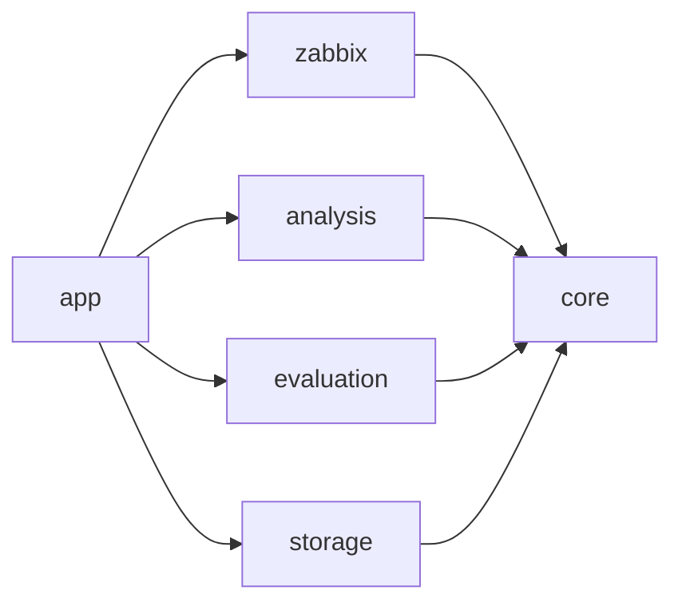

# Модули и контракты

Статус: **целевая структура**, каркас переделываем в спринте 2 ([D-008](decisions.md)). Модули общаются только через порты — интерфейсы в `core`, поэтому каждый может делать свой модуль параллельно, а вместо неготовой реализации стоит заглушка.

## Репозиторий

| Папка | Что внутри |
|---|---|
| `core` | Модели (проблема, инцидент, подозреваемый, доказательство, разметка) и порты. Без фреймворков |
| `zabbix` | Клиент JSON-RPC API и приём коннектора |
| `analysis` | Карта связей, объединение в инцидент, базовый подход, ранжирование, доказательства; позже ML |
| `evaluation` | Сверка разборов с разметкой, точность, сравнение подходов |
| `storage` | БД сервиса: инциденты, разборы, разметка, оценки |
| `app` | Spring Boot: конвейер, REST API для модуля и стенда, конфигурация |
| `zabbix-module` | Модуль интерфейса Zabbix: `manifest.json`, PHP-действия, JS |
| `deploy` | `compose.yaml` стенда: Zabbix, test-server, сервис, модуль; скрипт настройки Zabbix |

## Карта модулей

## Порты

| Порт | Что делает | Реализация | Требования |
|---|---|---|---|
| `ProblemSource` | Отдаёт события о проблемах из коннектора и догоняет пропуски | `zabbix` | FR-01 |
| `ZabbixHistory` | История метрик и логов хоста за интервал | `zabbix` | FR-02 |
| `ServiceMap` | Кто кого вызывает, кто отвечает за сервис | `analysis` (по тегам из `zabbix`) | FR-03, FR-08 |
| `IncidentCorrelator` | Объединяет проблемы в инцидент | `analysis` | FR-04 |
| `SuspectRanker` | Ранжирует подозреваемых; две реализации — базовая и наша | `analysis` | FR-05, FR-10 |
| `EvidenceCollector` | Подбирает отклонившиеся метрики и строки логов | `analysis` | FR-06 |
| `ReportPublisher` | Публикует разбор комментарием к проблеме | `zabbix` | FR-07 |
| `QualityEvaluator` | Сверяет разборы с разметкой | `evaluation` | FR-09, FR-10 |
| `IncidentStore`, `LabelStore` | Хранение | `storage` | NFR-07 |

## Внешние контракты

| Откуда → куда | Путь | Формат |
|---|---|---|
| Zabbix коннектор → сервис | `POST /zabbix/events` | NDJSON событий Zabbix, ответ 200 |
| test-server → сервис | `POST /api/v1/labels` | Разметка сбоя; контракт test-server не меняем |
| Модуль → сервис | `GET /api/v1/incidents`, `/api/v1/incidents/{id}`, `/api/v1/quality` | JSON |
| Сервис → Zabbix | `/api_jsonrpc.php` | JSON-RPC 2.0, токен API |

test-server сейчас ещё отправляет `POST /api/v1/telemetry`. В новой схеме метрики и логи идут через Zabbix, поэтому отправку телеметрии в test-server нужно отключить настройкой, оставив только разметку.

## Правила зависимостей
- `core` ни от чего не зависит.
- Модули не зависят друг от друга напрямую — только от `core`. Собирает их `app`.
- Разметку читает только `evaluation`.
