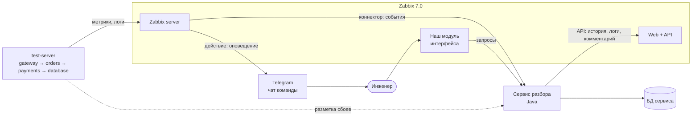
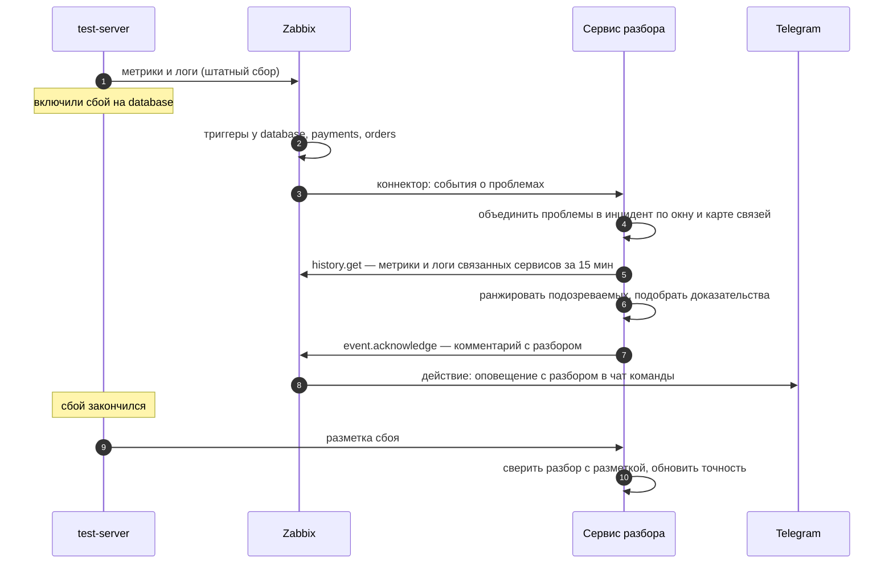

# Обзор архитектуры

Статус: **черновик** под расширение Zabbix ([D-004](decisions.md)). Детали механизмов Zabbix — в [zabbix-integration.md](zabbix-integration.md), модули сервиса — в [modules.md](modules.md).

Расширение работает рядом с Zabbix 7.0 и не меняет его ядро. Zabbix собирает данные и открывает проблемы. Наш сервис получает события, сам ходит за историей, делает разбор и возвращает его в Zabbix и в Telegram.

## Контекст

## Компоненты

| Компонент | Что делает | Чьё | Требования |
|---|---|---|---|
| test-server | Четыре сервиса со сбоями по кнопке; отдаёт метрики, пишет логи, присылает разметку | наш, [репозиторий](https://github.com/ITMO-DWS-Green/test-server) | — |
| Zabbix server + agent 2 | Собирает метрики и логи, проверяет триггеры, открывает проблемы, рассылает оповещения | Zabbix | — |
| Zabbix web + API | Интерфейс и JSON-RPC API | Zabbix | — |
| Сервис разбора | Принимает события, строит инциденты, делает разбор, публикует результат, считает точность | наш, этот репозиторий | FR-01…FR-10 |
| БД сервиса | Инциденты, разборы, разметка, оценки | наш | NFR-07 |
| Модуль интерфейса | Карточка инцидента и страница точности внутри Zabbix | наш | FR-11, FR-12 |
| Telegram | Групповые чаты команд | внешний | FR-08 |

## Главный сценарий

## Ключевые свойства
- **Не дублируем Zabbix.** Метрики, логи и триггеры живут в Zabbix; у нас только инциденты, разборы и оценки.
- **Честная оценка.** Разметка идёт от стенда напрямую в сервис и не участвует в разборе. Элементы Zabbix, по которым видно включённый сценарий, разбор не читает (NFR-10).
- **Два подхода на одних данных.** Базовый подход и наш разбор получают одни и те же инциденты — иначе сравнение нечестное.
- **Устойчивость.** Если сервис был недоступен и коннектор потерял события, сервис догоняет пропуски через `problem.get` и `history.get`.

## Что не входит
Свой сбор и хранение метрик, свои триггеры, своё веб-приложение, агент — всё это даёт Zabbix. Старый каркас с приёмом телеметрии и генератором удаляем ([D-008](decisions.md)).
