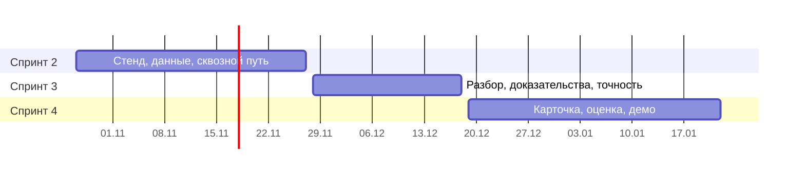

# Дорожная карта

Всего 4 спринта, защита в январе. Спринт 1 позади, на MVP остаются три. Идеи взяты из документа Евгения Матеюка «Расширение Zabbix · 25 идей по приоритету» (26.10.2026); номер идеи — её место в очереди.

**Сценарий защиты:** включили сбой на test-server → сработал триггер в Zabbix → расширение назвало источник и доказало это данными → разбор пришёл в Telegram → показали точность на десятках прогонов.

## Спринт 2 · до 27.11 · сквозной путь
Цель: проблема в Zabbix доходит до Telegram через наш сервис, пусть пока с простым разбором.

- единый стенд: Zabbix + test-server + наш сервис одной командой;
- логи test-server попадают в Zabbix;
- коннектор событий и клиент API Zabbix (FR-01, FR-02);
- карта связей по тегам (FR-03, идея 6), объединение проблем в инцидент (FR-04);
- базовый разбор «первый сработавший триггер» → комментарий в Zabbix и Telegram (FR-07, FR-08, идея 9);
- приём разметки test-server (часть FR-09);
- проба модуля интерфейса Zabbix: пустая страница с запросом в наш сервис.

## Спринт 3 · до 18.12 · настоящий разбор
- ранжирование «кто отклонился первым» (FR-05, идея 1);
- доказательства из логов (FR-06, идея 2);
- точность на стенде и сравнение с базовым подходом (FR-09, FR-10, идея 7);
- начало карточки инцидента (FR-11, идея 5).

## Спринт 4 · до 22.01 · интерфейс и защита
- карточка инцидента и страница точности в модуле (FR-11, FR-12);
- прогоны всех плейбуков, отчёт о точности и ограничениях;
- README, документация, демо, презентация.

## Если успеем — по порядку
| Очередь | Идея | Требование |
|---|---|---|
| 1 | ML: аномалии по группе метрик сервиса (22) и норма метрики (18) | FR-13 |
| 2 | Причина и симптомы (8) | FR-15 |
| 3 | Пересказ LLM и маскирование (3, 4) — если заказчик разрешит внешнюю модель | FR-14 |
| 4 | Оценка разбора инженером (13) | FR-17 |
| 5 | Похожие прошлые инциденты (10) | FR-16 |

Остальные идеи (11, 12, 14–17, 19–21, 23–25) — после защиты.
